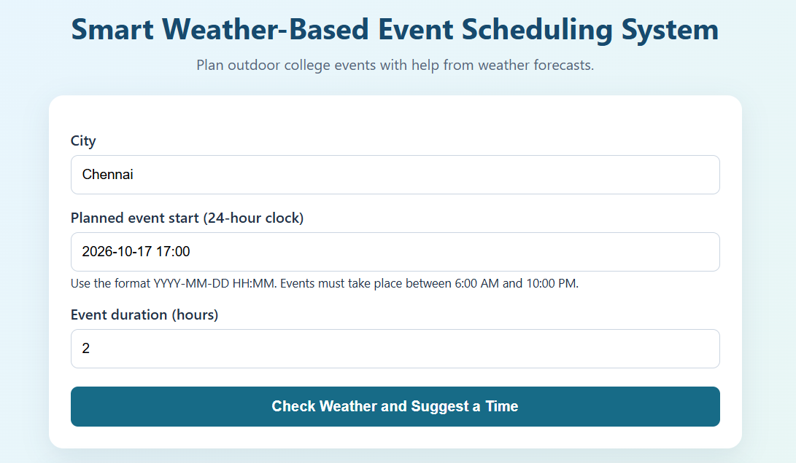
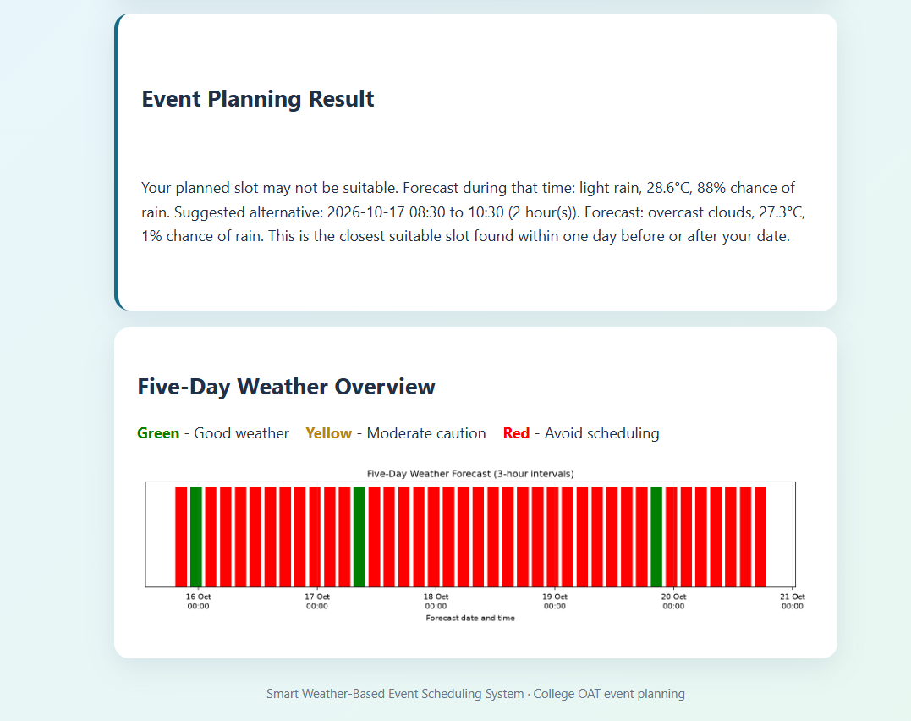

# Smart Weather-Based Event Scheduling System

A small Flask web application for checking forecast conditions and finding a nearby alternative time for outdoor events, such as events at a college Open Air Theatre (OAT).

## Screenshots

**Event input form**



**Weather check, suggested time and five-day forecast overview**



## Files

- `app.py` — Flask web application and form handling.
- `weather_utils.py` — OpenWeatherMap forecast retrieval, slot evaluation, and chart generation.
- `templates/index.html` — Web page layout and styling.
- `static/` — Generated forecast chart.

## Setup (Windows / VS Code)

1. Install Python 3.13 or another supported Python 3 version.
2. Open this folder in VS Code.
3. In the VS Code terminal, install dependencies:

   ```powershell
   python -m pip install flask requests matplotlib
   ```

4. Create an OpenWeatherMap API key at https://openweathermap.org/api.
5. In the same PowerShell terminal, set the key for that terminal session:

   ```powershell
   $env:OPENWEATHER_API_KEY="PASTE_YOUR_API_KEY_HERE"
   ```

   Do not share or commit your API key. If you have previously exposed a key publicly, regenerate it.

6. Run the app:

   ```powershell
   python app.py
   ```

7. Open http://127.0.0.1:5000 in your browser.
8. Stop the server with `Ctrl+C` in the terminal.

## Important forecast limitation

The free OpenWeatherMap 5-day forecast endpoint returns entries at 3-hour intervals, not exact hourly predictions. The application therefore estimates conditions for a requested event duration. It searches only the available forecast and attempts to stay within one day before or after the requested date; it cannot provide reliable forecasts for dates outside the API's forecast window.

The suggested weather thresholds are simple rules and should be treated as planning guidance, not a guarantee of safe conditions.
